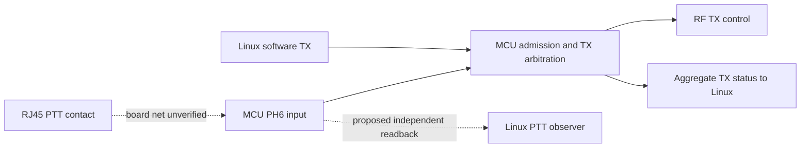

# Internal mic-PTT observation: software investigation result

The preferred implementation stays inside the radio. UP/DOWN decoding is out of
scope. Physical measurements are reserved; no breakout, probe or external PTT
interface is required by this plan.

## What the existing software establishes

The manufacturer's [September 2024 manual, PDF page 12](https://radioddity.s3.amazonaws.com/Xiegu_X6200_Manual_20240925.pdf#page=12)
labels PTT, MDATA and MSVSW as separate RJ45 signals. It also identifies MIC,
MICE, GND, NC and +8 V. The diagram establishes separate signal roles, not the
net from that connector to a particular MCU pin. No numeric pin assignment or
electrical continuity measurement is claimed here.

The identified MCU physical-PTT handler reads GPIOH IDR bit 6, active low. The
raw input can exist independently of whether RF transmission is permitted.
Host/frequency/mode admission precedes the legacy sample in this handler; its
stored byte is shared with tuning/software TX. The software aggregator clears
that byte. This is why neither that byte nor aggregate TX supplies the independent
physical release needed by the Linux digital-voice controller.

The completed Linux GPIO round sampled both R16 pin controllers. PG10 followed
the radio side PTT. No bank DATA bit changed during either mic-PTT interval.
All 1,642 sampled MCU packets passed an independently recomputed CRC. The two
unequal repeat reads also ended with CRC-valid samples. This narrows the search;
it does not exclude another interface or a value hidden by the current pin mux.
The panel event did not assert the MCU TX flag in this round, despite the
operator's general TX-indicator note; that discrepancy is retained separately.

## Existing MCU access paths checked

The supplied 1.0.8 plaintext hash matches the full report. A new Ghidra 12.2
project was imported at 0x08020000 with Cortex-M Thumb context and the reset's
22,232-byte initialized AXI data copy from flash 0x0806ea50 to RAM 0x24000000.
Selected console callback entries were explicitly recovered from their 14-entry
table. Critical reads, GPIO accesses and computed I2C cases were checked against
Thumb assembly. This is a targeted audit, not complete recovery of all firmware.

| Path | Recovered behavior | Independent raw PTT found? |
| --- | --- | --- |
| I2C read dispatcher 0x08044b54 | Fixed banks/cases for metadata, calibration, VFO values, RX volume, spectrum decimation, readiness and CW text/speed. Other reads fall back to zero. | No |
| I2C 0xfffe special-command mailbox | Main-loop command cases 0x8002/3/4/5/9/a perform initialization/calibration/other control work or bootloader entry. No general memory/GPIO read operation was identified. | No |
| Console TRX display 0x0803f318 | Reads software/console latch 0x2402506d and prints TX/RX. | No |
| Console TRX input 0x0803f35c | Toggles that latch, copies it into shared state 0x24025074 and reconciles TX. It changes TX; it is not a passive query. | No |
| Other inspected console callbacks | VFO, mode, preamp, bias, volume, SNR, filters, ATU and bootloader controls. | No generic memory/pin read identified |
| MCU USART1 console | Configured for 115200 baud; host connection/wiring unverified. Linux /dev/ttyS2 is the application's CI-V CAT endpoint, not established as this console. | No usable raw-read path established |

The normal I2C address is a 16-bit selector, not an MCU memory address. Linux
`/dev/mem` exposes the R16 physical address space; it does not make the separate
MCU's GPIO or SRAM directly readable. Opening another MCU UART reader would
compete with the existing reader and would not create a missing protocol field.

The machine-readable [audit](ptt-interface-audit-2026-11-05.json) contains the
exact fixed read ranges and computed-branch targets. The existing UART status
capture and R16 GPIO capture remain physical evidence; static analysis alone
does not prove that every other firmware/hardware interface is absent.

## Internal implementation to prepare

The strongest software path identified is an MCU interface extension, consumed
by Linux through the existing I2C connection. This needs no external adapter.
It does not depend on putting the voice codec/modem on the MCU.

1. Add an independent raw-input observation before host/mode/frequency admission
   and before legacy shared-state updates. Do not reinterpret the legacy shadow
   or aggregate TX as raw input.
2. Expose a versioned read-only observation containing current level, validity,
   a boot identity, an edge sequence and a retained release sequence. These
   observations must continue while software/MODEM TX stays asserted.
3. Return a consistent snapshot for an entire read transaction. A snapshot that
   cannot be obtained immediately must report unavailable/busy, not spin inside
   an interrupt and prevent the input writer from completing. Define debounce,
   counter wrap and minimum observable pulse timing explicitly.
4. Bind Linux's per-source PTT observer to that interface. Verify retained
   release across a short release/re-press and invalidate observations after an
   MCU restart. Keep the existing aggregate-TX observation separate.
5. Qualify the connector/source attribution and overlap behavior before enabling
   native TX. This PTT interface alone does not resolve audio routing, physical
   inhibition, applied-route acknowledgment or the native lease contract.

No wire selector, patch address, RAM reservation or compatibility identifier has
been assigned. The above is a proposed interface, not an existing stock command.
No capability bit or working profile has been fabricated to bypass the current
Linux backend's unsupported state.

## Installation feasibility still unresolved

The application jump stub enters the 128 KiB bootloader region at 0x08000000,
which is absent from the supplied MCU application. The acquired stock rootfs
archive lists one MCU firmware file, the same 524,288-byte application XGF; no
separate bootloader file was identified by its firmware/MCU/bootloader names.
This does not exclude an embedded copy elsewhere in the distribution.

Decrypting the application does not establish modified-image validation,
checksum/signature handling, flash write/recovery or bootloader acceptance.
Those are the next software evidence gaps before producing a flashable MCU
candidate. Preserve the current radio installation while investigating them.
No new image, RF test, UART command, I2C probe or firmware flash was performed
as part of this audit.

## Reproduction

The source scripts are in `tools/freedv/baseband/ghidra-ptt/`. Supply the exact
decrypted input whose SHA256 is recorded in the JSON audit. Import as
`ARM:LE:32:Cortex:default`, BinaryLoader base 0x08020000; run `PttSetup.java`
before analysis. In the saved project run `PttRefine.java` before analysis,
then `PttFocusedExport.java <output-directory>` afterward. The refinement models
the reset-time initialized RAM copy; it does not patch the application file.
Record Ghidra warnings and unresolved indirect branches. Do not treat recovered
C types or successful decompilation as proof of electrical or real-time behavior.
